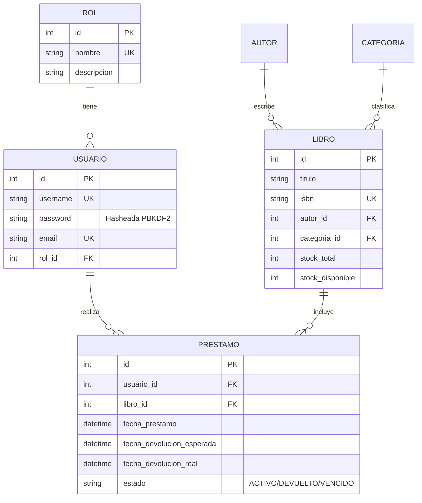

# Guía de Demostración y Defensa Técnica del Proyecto

**Asignatura:** Utilización de Frameworks para el Desarrollo de Software  
**Docente:** Oscar Alfredo Cruz Rovira  
**Proyecto:** API REST para el Manejo de un Sistema Bibliotecario  

Esta guía está diseñada para que puedas defender el proyecto con total solvencia técnica ante el docente utilizando **Postman** o el navegador, respondiendo a las preguntas de la rúbrica y demostrando cada flujo en vivo.

---

## 1. Mapeo del Proyecto con la Rúbrica de Evaluación

### Competencia 1: Modela la solución y los datos (20%) - Nivel 4 (100%)
*Criterio: "Modelo coherente, normalizado según necesidad, restricciones claras y relaciones justificadas."*

- **¿Cómo lo argumentas?**
  - **Normalización:** La base de datos está normalizada en Tercera Forma Normal (3FN). Las entidades `Autor` y `Categoria` están desacopladas de `Libro` mediante claves foráneas (`ForeignKey`). La entidad `Rol` está desacoplada de `Usuario` para permitir escalabilidad y control de permisos granular (RBAC).
  - **Integridad Referencial:** Se utiliza la política `on_delete=models.RESTRICT` en las relaciones críticas. Si un libro tiene registros en la tabla `Prestamo`, el motor de base de datos y la API impiden su eliminación física para mantener la integridad histórica de los registros bibliotecarios (cumpliendo con la **Regla de Negocio 7**).
  - **Campos de Auditoría:** Todas las tablas cuentan con `created_at` (`auto_now_add=True`) y `updated_at` (`auto_now=True`), tal como se enseñó en las Semanas 10 y 11.
  - **Control de Ejemplares:** El modelo `Libro` maneja `stock_total` y `stock_disponible` con validación en `clean()` que garantiza que `stock_disponible <= stock_total` y que ningún valor sea negativo.



---

### Competencia 2: Construye servicios REST funcionales (25%) - Nivel 4 (100%)
*Criterio: "Todos los flujos obligatorios funcionan; diseño REST consistente; validaciones y errores correctos."*

- **¿Cómo lo argumentas?**
  - **Métodos HTTP adecuados:** 
    - `POST` para creación (retorna `201 Created`).
    - `GET` para consulta (retorna `200 OK`).
    - `PUT`/`PATCH` para actualización (retorna `200 OK`).
    - `DELETE` para eliminación (retorna `204 No Content`).
  - **Códigos de Estado y Manejo de Errores:**
    - `400 Bad Request`: cuando se envían datos inválidos o cuando se intenta prestar un libro sin stock disponible (`stock_disponible == 0`).
    - `401 Unauthorized`: cuando se consume una ruta protegida sin token o con credenciales erróneas.
    - `403 Forbidden`: cuando el usuario está autenticado pero su rol no tiene los privilegios requeridos para esa operación.
    - `404 Not Found`: cuando el recurso solicitado no existe.
  - **Transacciones Atómicas:** Las operaciones de creación de préstamo y devolución se ejecutan dentro de bloques `with transaction.atomic()` y con bloqueo de fila `select_for_update()` para prevenir condiciones de carrera en entornos concurrentes.

---

### Competencia 3: Implementa autenticación y seguridad por token (25%) - Nivel 4 (100%)
*Criterio: "Login seguro; contraseñas protegidas; token válido y con expiración; autorización efectiva; secretos fuera del código; no se exponen datos sensibles."*

- **¿Cómo lo argumentas?**
  - **Hash Seguro:** Se utiliza el mecanismo nativo de Django con algoritmo `PBKDF2 con SHA-256`, nunca se almacenan contraseñas en texto plano.
  - **Protección contra enumeración de usuarios (Regla 5):** Si las credenciales fallan, la API devuelve siempre un mensaje genérico `"Credenciales inválidas. Por favor verifique sus datos de acceso."` con código `401`, impidiendo a un atacante deducir si el nombre de usuario existe en la base de datos.
  - **Tokens JWT con Tiempo de Expiración:** Configurado en `settings.py` con `rest_framework_simplejwt`:
    - `ACCESS_TOKEN_LIFETIME = timedelta(hours=2)`
    - `REFRESH_TOKEN_LIFETIME = timedelta(days=1)`
    - Validados mediante el encabezado estándar: `Authorization: Bearer <token>`.
  - **Control de Roles (RBAC):**
    - `IsAdminUserRole`: Solo `ADMINISTRADOR`.
    - `IsBibliotecarioOrAdmin`: Para registro de libros, préstamos y devoluciones.
    - `IsBibliotecarioOrAdminOrReadOnly`: Lector puede ver (`GET`), pero no crear/modificar (`POST`/`PUT`/`DELETE`).

---

### Competencia 4: Calidad técnica, pruebas y documentación (20%) - Nivel 4 (100%)
*Criterio: "Proyecto organizado y reproducible; documentación completa; pruebas cubren casos positivos y negativos; errores controlados."*

- **Estructura Modular (Estilo de las Semanas 10-14):**
  - Modelos separados en `biblioteca/models/` (`rol.py`, `usuario.py`, `autor.py`, `categoria.py`, `libro.py`, `prestamo.py`).
  - Serializadores separados en `biblioteca/serializers/`.
  - Vistas organizadas en `biblioteca/views/`.
  - Permisos en `biblioteca/permissions.py`.
- **Reproducibilidad Inmediata:**
  - `python manage.py migrate`
  - `python manage.py seed_biblioteca` (pobla usuarios, roles y catálogo con 1 solo comando).
- **Colección de Postman:**
  - `Postman_Collection_Sistema_Bibliotecario.json` lista para importar y probar de forma gráfica todos los flujos obligatorios.

---

### Competencia 5: Demuestra y argumenta la solución (10%) - Nivel 4 (100%)
*Criterio: "Demuestra todos los flujos, explica decisiones técnicas y responde con evidencia del sistema."*

---

## 2. Paso a Paso para la Demostración en Postman

Durante la presentación frente al profesor Oscar Alfredo Cruz Rovira:

### Paso 1: Levantar el servidor
Abre una terminal y ejecuta:
```bash
python manage.py runserver
```

### Paso 2: Abrir Postman e Importar la Colección
1. Abre Postman.
2. Haz clic en **Import** y selecciona el archivo `Postman_Collection_Sistema_Bibliotecario.json` que está en la carpeta raíz del proyecto.
3. Verás las carpetas organizadas por módulos:
   - `1. Autenticación (Auth & JWT)`
   - `2. Catálogo (Autores, Categorías y Libros)`
   - `3. Préstamos y Devoluciones`

### Paso 3: Demostrar los Flujos Solicitados en la Guía
1. **Flujo 1 (Login y Token):**
   - Ejecuta la petición `Login - Bibliotecario`.
   - Muestra que responde `200 OK` y devuelve el `token` JWT y los datos del usuario. El script guarda automáticamente el token en las variables de Postman.
2. **Flujo 2 (Ruta protegida sin token):**
   - Ejecuta `Ruta protegida SIN token`.
   - Muestra que responde `401 Unauthorized` denegando el acceso.
   - Luego ejecuta `Perfil Usuario Autenticado (/auth/me/)` y muestra que con token sí responde `200 OK`.
3. **Flujo 3 (Permisos por rol):**
   - Ejecuta `Crear Libro - Denegado (Lector 403 Forbidden)` usando token de Lector. Responde `403 Forbidden`.
   - Luego ejecuta `Crear Libro - Autorizado (Bibliotecario)` usando token de Bibliotecario. Responde `201 Created`.
4. **Flujo 4 (Consulta de catálogo):**
   - Ejecuta `Listar Libros Disponibles`. Muestra los libros disponibles con su stock.
5. **Flujo 5 (Préstamo válido):**
   - Ejecuta `Registrar Préstamo Válido`. Muestra que responde `201 Created` y que el stock disponible del libro disminuye en 1.
6. **Flujo 6 (Préstamo de libro agotado):**
   - Ejecuta `Intentar Préstamo de Libro Agotado` (libro Fundación que tiene stock 0).
   - Muestra que la API rechaza la solicitud con `400 Bad Request` indicando que no hay ejemplares disponibles.
7. **Flujo 7 (Devolución):**
   - Ejecuta `Registrar Devolución`.
   - Muestra que responde `200 OK`, el estado cambia a `DEVUELTO` y el stock disponible del libro se restablece a su valor original.

---

## 3. Preguntas Frecuentes del Docente y Respuestas Técnicas

**P1: ¿Por qué usaron un modelo de usuario personalizado en lugar del User por defecto de Django?**  
*Respuesta:* "Porque tal como se explicó en la Semana 14, para asociar el usuario directamente a nuestra tabla de `Rol` y agregar campos como teléfono y dirección, la buena práctica oficial de Django es heredar de `AbstractUser` y sobreescribir `UsuarioManager` con `create_superuser` para garantizar que los superusuarios queden correctamente vinculados al rol de Administrador."

**P2: ¿Cómo garantizan que dos bibliotecarios prestando el último ejemplar al mismo tiempo no causen stock negativo?**  
*Respuesta:* "Utilizamos transacciones atómicas de base de datos con `transaction.atomic()` y bloqueo pesimista mediante `select_for_update()`. Esto asegura que mientras una solicitud descuenta el stock, la otra debe esperar y al verificar encuentra stock 0, rechazando el segundo préstamo con un `400 Bad Request` controlado."

**P3: ¿Qué pasa si intentamos eliminar un libro que ya tiene préstamos históricos registrados?**  
*Respuesta:* "La clave foránea del préstamo hacia el libro está configurada con `on_delete=models.RESTRICT`. Si se intenta eliminar ese libro mediante `DELETE /api/libros/<id>/`, el sistema captura la excepción `RestrictedError` y responde con un código `400 Bad Request` explicando que no se puede eliminar porque cuenta con historial de préstamos asociado, protegiendo la integridad referencial exigida en la Regla 7."

**P4: ¿Por qué el login responde con 401 y el mismo mensaje tanto si el usuario no existe como si la clave está mala?**  
*Respuesta:* "Por la Regla de Seguridad 5 del documento. Si el sistema respondiera 'El usuario no existe', un atacante podría deducir qué nombres de usuario están registrados (ataque de enumeración). Al devolver un mensaje genérico, protegemos la confidencialidad del sistema."
